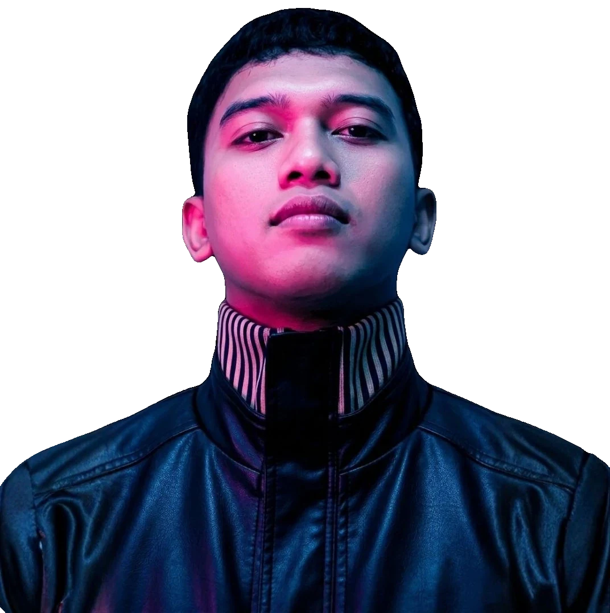
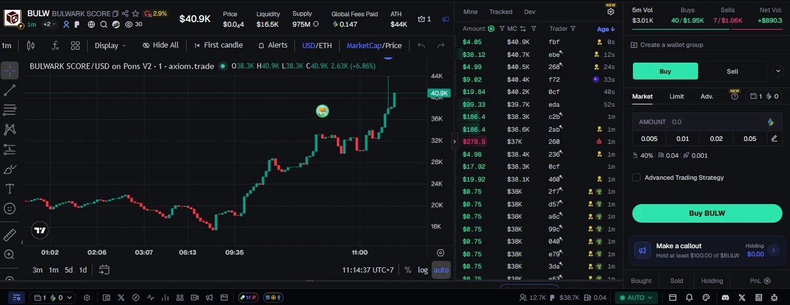
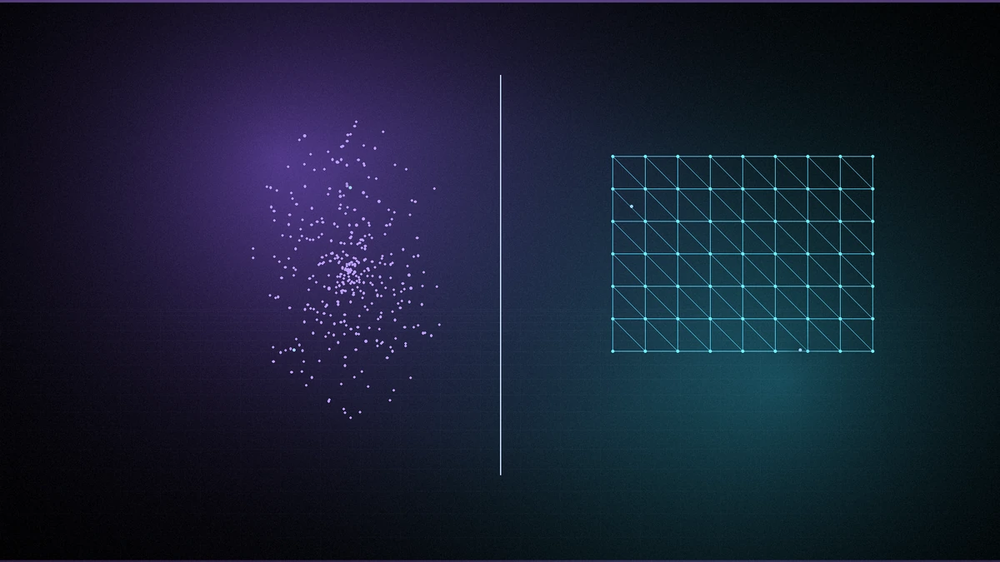
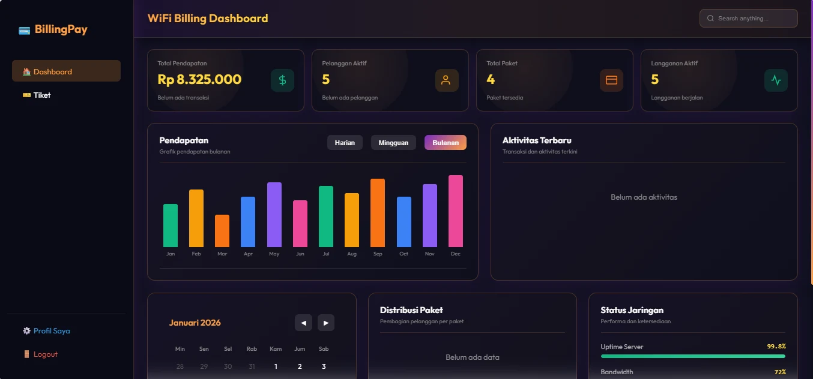
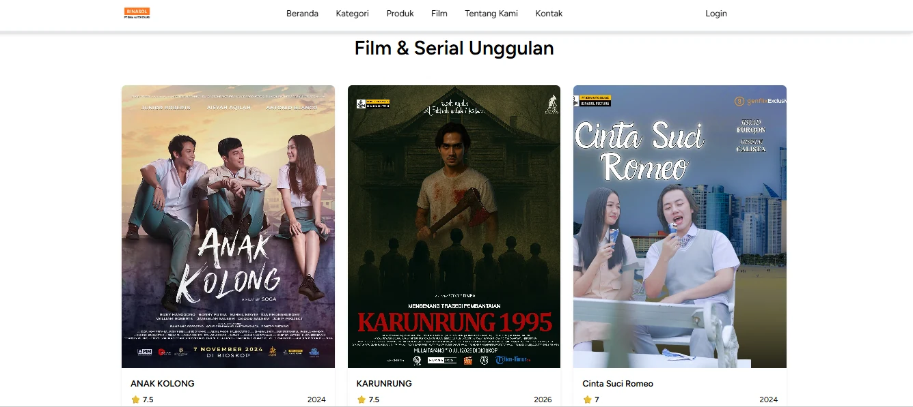

<div align="center">

<!-- Pengalih bahasa -->
<a href="README.md"></a>
<a href="README.id.md"></a>

<br/>


<a href="https://github.com/Codeby-Javier">
  
</a>

<br/>


<br/><br/>

<a href="https://github.com/Codeby-Javier"></a>
<a href="https://gitlab.com/Codeby-Javier"></a>
<a href="mailto:javieribnu12@gmail.com"></a>

</div>

---

<table>
<tr>
<td width="38%" align="center" valign="middle">
  
</td>
<td width="62%" valign="top">

## Tentang saya

Saya **fullstack web developer** dari **Yogyakarta**. Saya suka menguasai seluruh alur — skema database, API, antarmuka, deployment — plus pengujian yang menjaga semuanya jujur.

| | Yang saya bawa |
| :--- | :--- |
| **Backend** | Sistem yang tetap cepat saat data membesar |
| **Frontend** | Antarmuka di mana gerak, tipografi, dan struktur berbicara |
| **Web3** | Produk yang bisa diverifikasi — bukan sekadar buzzword |
| **QA** | Kalau belum diuji, belum siap di-ship |
| **Desain** | Insting UI/UX dari Figma sampai produksi |

> *Kode adalah medium saya. Rasa ingin tahu adalah mesinnya.*

</td>
</tr>
</table>

<div align="center">

### Belajar → Bangun → Rusak → Perbaiki


</div>

---

## Skill sekilas

<div align="center">

### Bahasa pemrograman

<a href="https://skillicons.dev">
  
</a>

<br/><br/>

| Bahasa | Badge | Warna |
| :---: | :---: | :---: |
| **Rust** |  | `#000000` |
| **Go** |  | `#00ADD8` |
| **Python** |  | `#3776AB` |
| **PHP** |  | `#777BB4` |
| **JavaScript** |  | `#F7DF1E` |
| **TypeScript** |  | `#3178C6` |
| **SQL** |  | `#4479A1` |
| **Solidity** |  | `#363636` |

</div>

---

### Frontend & desain

<div align="center">

<a href="https://skillicons.dev">
  
</a>

<br/><br/>


</div>

| Skill | Dipakai untuk |
| --- | --- |
| **React / Next.js** | UI berbasis komponen, routing, permukaan produk SSR/SSG |
| **TypeScript** | Kontrak bertipe di frontend dan modul bersama |
| **Tailwind / Bootstrap** | Layout cepat dan styling design system yang konsisten |
| **Figma** | Sistem UI, prototipe, dan layar siap handoff |
| **Alpine.js** | Interaktivitas ringan tanpa SPA yang berat |

---

### Backend, data & platform

<div align="center">

<a href="https://skillicons.dev">
  
</a>

<br/><br/>


</div>

| Domain | Kemampuan |
| --- | --- |
| **Desain API** | Layanan REST, alur auth, validasi, batas domain yang bersih |
| **Lapisan data** | Store relasional + dokumen + analitik; indexing dan caching |
| **Arsitektur** | Backend modular, delivery ber-Docker, struktur ramah CI |
| **Performa** | Tuning query, strategi cache, API yang sadar observability |

---

### Web3 & jaminan kualitas

<div align="center">

<a href="https://skillicons.dev">
  
</a>

<br/><br/>


</div>

| Area | Cara kerja saya |
| --- | --- |
| **Smart contract** | Solidity + Foundry untuk logika on-chain yang terverifikasi |
| **Klien dApp** | Alur wallet dan baca/tulis on-chain berbasis viem |
| **Pengujian E2E** | Cakupan Playwright untuk perjalanan pengguna kritis |
| **Pengujian API** | Koleksi Postman untuk kontrak dan regresi |
| **Kebersihan keamanan** | Scan OWASP ZAP dan kebiasaan ship yang sadar ancaman |

---

## Peta kemampuan

<div align="center">

| Pilar | Kekuatan | Sinyal stack |
| :---: | --- | --- |
|  | API, model data, sistem yang scalable | `Rust` `Go` `Bun` `Laravel` `Django` |
|  | Gerak, tipografi, struktur, design system | `React` `Next.js` `TypeScript` `Tailwind` |
|  | Provenance, wallet, produk on-chain | `Solidity` `Foundry` `viem` |
|  | Otomasi yang mencegah regresi | `Playwright` `Postman` `OWASP ZAP` |

</div>

---

## Karya unggulan

<table>
<tr>
<td width="50%" valign="top">
  <a href="https://bulwarkproof.tech/"></a>
  <h3>Bulwark <sub>· LIVE</sub></h3>
  <p>Meja trading live dengan data pasar nyata dan hasil on-chain yang terverifikasi.</p>
  <p>
    
    
    
  </p>
</td>
<td width="50%" valign="top">
  <a href="https://gitlab.com/razorxpredator/outsmart"></a>
  <h3>OutSmart</h3>
  <p>Arena ahli vs AI dan marketplace benchmark privat dengan provenance on-chain.</p>
  <p>
    
    
    
  </p>
</td>
</tr>
<tr>
<td width="50%" valign="top">
  <a href="https://github.com/Codeby-Javier/billingpay-wifi-golang"></a>
  <h3>BillingPay WiFi</h3>
  <p>Billing ISP open-source untuk operator RT/RW Net.</p>
  <p>
    
    
  </p>
</td>
<td width="50%" valign="top">
  <a href="https://pt-binasol.com/"></a>
  <h3>PT Binasol</h3>
  <p>Platform korporat — API Laravel + frontend Next.js, didesain di Figma.</p>
  <p>
    
    
    
  </p>
</td>
</tr>
</table>

---

## Statistik & grafik bergerak

<div align="center">


<br/>


<br/>


<br/>


<br/>


</div>

---

## Sedang dieksplorasi

<div align="center">


</div>

---

## Tentang portfolio ini

Repo ini adalah portfolionya sendiri — situs sinematik berbasis scroll dengan tipografi pinned, About interaktif, perjalanan proyek 3D, dan robot Spline yang mengikuti kursor.

- **HTML, CSS, JS polos** — tanpa framework, tanpa build step
- **Animasi scroll yang bisa di-scrub** — berhenti dan mundur mengikuti scroll
- **First paint ringan** — aset 3D berat baru di-hydrate saat mendekat
- **Aksesibel** — `prefers-reduced-motion`, fallback sentuh, hero tanpa JS

```bash
python -m http.server 4173
# buka http://localhost:4173
```

📘 **[Panduan build lengkap →](GUIDE.md)** · 🇺🇸 **[Read in English →](README.md)**

---

<div align="center">

### Yuk bangun sesuatu yang bertahan lama.

Terbuka untuk peran fullstack, proyek freelance, dan masalah yang menarik.

<a href="mailto:javieribnu12@gmail.com"></a>
<a href="https://github.com/Codeby-Javier"></a>
<a href="https://gitlab.com/Codeby-Javier"></a>

<br/>

<a href="README.md"></a>
<a href="README.id.md"></a>


<sub>© 2026 Ibnu Javier Zaenuri · Dibangun dengan kode dan rasa ingin tahu.</sub>

</div>
